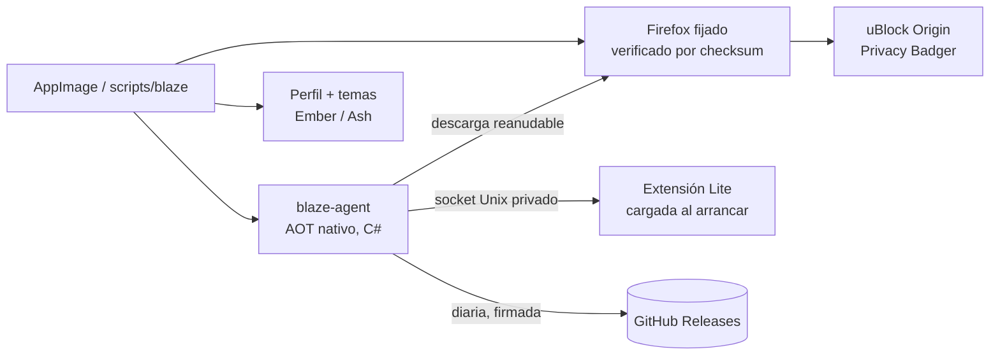

<p align="center">
  
</p>

<h1 align="center">Blaze</h1>

<p align="center">
  <b>Un navegador basado en Firefox, pensado para la velocidad y la ligereza.</b><br>
  Menos bytes por página, descargas que se reanudan, privado por defecto y una interfaz que no estorba.
</p>

<p align="center">
  <a href="https://vezzulab.github.io/blaze/es/">Sitio web</a> ·
  <a href="PRIVACY.md">Privacidad</a> ·
  <a href="SECURITY.md">Seguridad</a> ·
  <a href="docs/BENCHMARKS.md">Mediciones</a> ·
  <a href="README.md">English</a>
</p>

<p align="center">
  
  
  
</p>

<p align="center">
  
</p>

---

## Qué es Blaze

Blaze es un **navegador basado en Firefox**: una distribución del motor oficial de Firefox (Gecko), ajustada para quienes tienen conexiones lentas o con datos limitados y para equipos con poca memoria. Ejecuta el Firefox real, sin modificar, así que toda la web moderna funciona, incluidos YouTube, Spotify y tus extensiones. Encima, Blaze agrega:

- un perfil ajustado (menos procesos, cachés pequeñas en memoria, una caché grande y persistente en disco, sin tráfico de fondo),
- un **modo Lite** de un clic,
- un **motor de descargas que se reanuda**,
- una interfaz mínima con dos temas,
- un lanzador que fija un Firefox probado y un actualizador firmado que te dice qué cambió antes de que decidas.

Blaze **no** es un fork a nivel de código fuente y no modifica Gecko. Todo lo que no es Firefox vive en este repositorio y es lo bastante pequeño para leerse en una tarde.

> **Software en alfa.** Funciona de punta a punta (ver [Estado](#estado)), pero es joven. Lee los límites antes de depender de él.

## Por qué existe

Una página liviana en una línea rápida puede tardar minutos en una mala. Blaze ataca lo que sí se puede controlar: **cuántos bytes cuesta una página** y **qué pasa cuando la conexión se cae**.

| Abrir cnn.com, sin caché | Datos | Tiempo calculado a 256 kbps |
|---|---:|---:|
| Firefox, tal como viene | 6,8 MB | 3 min 41 s |
| Blaze | 4,7 MB (**-31 %**) | 2 min 33 s |
| Blaze con Lite | 3,8 MB (**-44 %**) | 2 min 5 s |

| Memoria, todos los procesos juntos | Firefox | Blaze | |
|---|---:|---:|---:|
| Una pestaña en blanco | 815 MB | 522 MB | **-36 %** |
| Una pestaña, Wikipedia | 878 MB | 637 MB | **-27 %** |
| Cuatro páginas abiertas | 1021 MB | 689 MB | **-33 %** |

**Léelo con honestidad.** Una sola corrida por caso, en una sola máquina (Fedora 44, Firefox 159 sin ventana, memoria como PSS). Los tiempos se calculan a partir de los bytes, no se midieron, porque el tiempo de red varía demasiado entre corridas. Unos 500 MB para una sola pestaña es el piso que encontramos con Gecko, y Blaze no puede abaratar una pestaña de video. Solo comparamos contra Firefox: **no** medimos otros navegadores y no afirmamos ser el navegador más ligero que existe. Método y límites: [docs/BENCHMARKS.md](docs/BENCHMARKS.md).

## Funciones

| | |
|---|---|
| **Modo Lite** | Un interruptor arriba a la derecha evita que se carguen imágenes, fuentes web y video. Entre 44 % y 61 % menos bytes en páginas de noticias pesadas. |
| **Descargas que se reanudan** | Motor multiconexión con estado persistente. Sobrevive a un cierre inesperado, un corte de luz o una conexión caída. Verificado con un `kill -9` a mitad de descarga. Mira el [límite](#límites-conocidos) más abajo. |
| **Extensiones** | uBlock Origin y Privacy Badger preinstalados. Funciona cualquier extensión de addons.mozilla.org. |
| **DRM** | Widevine está activado, así que Spotify y Netflix funcionan. Un ajuste lo apaga. |
| **Privado por defecto** | Sin telemetría, sin cuentas, solo HTTPS, protección estricta contra rastreo, sin notificaciones push web, sin consulta de región. Cada servidor con el que Blaze se conecta está en [PRIVACY.md](PRIVACY.md). |
| **A prueba de actualizaciones** | Blaze fija un Firefox concreto (verificado por checksum) y apaga el actualizador de Firefox, así que una actualización de origen no puede romper la interfaz. Una prueba de contrato de la interfaz vigila cada cambio de motor. |
| **Actualizaciones que decides tú** | Consulta GitHub una vez al día, muestra las notas de la versión y descarga solo si dices que sí. Las versiones se firman con ECDSA; Blaze rechaza lo que no se verifique. |
| **Dos temas** | **Ember** (oscuro) y **Ash** (claro), según tu sistema. Planos, compactos, sin desenfoques ni sombras, con el naranja como único acento. |
| **Pequeño** | La aplicación Blaze es un AppImage de 4,5 MB. Su agente es un binario nativo AOT (unos 10 MB de RAM mientras descarga). |

<p align="center">
  
</p>
<p align="center"><sub>Capturado de una ventana real de Blaze. Solo se ve la interfaz; el área de la página sale vacía por la forma en que se toman las capturas.</sub></p>

## Instalar

**AppImage (Linux x86_64)**

```bash
# 1. descarga Blaze-<versión>-x86_64.AppImage desde la página de Releases
chmod +x Blaze-*-x86_64.AppImage
./Blaze-*-x86_64.AppImage
```

Todavía no hay una versión publicada, así que por ahora compílalo desde el código (abajo). El primer arranque descarga Firefox 159 desde archive.mozilla.org (86 MB), lo verifica contra el SHA-256 fijado en [`engine.env`](engine.env) e instala uBlock Origin y Privacy Badger. Si lo interrumpes, se reanuda. Después Firefox baja unos 43 MB en segundo plano (Widevine 17, Safe Browsing 10, listas de bloqueo de Mozilla 8, listas de uBlock/Privacy Badger 5). Luego un arranque es casi silencioso.

**Desde el código** (necesita el SDK de .NET 10 con soporte AOT, `python3`, `curl`, `tar`, `xz`)

```bash
git clone https://github.com/vezzulab/blaze.git && cd blaze
dotnet publish src/Blaze.Agent -c Release -r linux-x64 -o dist/agent
scripts/blaze                      # ejecutar desde el repositorio
packaging/build-appimage.sh        # o construir dist/Blaze-<versión>-x86_64.AppImage
```

### Ajustes

Blaze mantiene sus interruptores deliberadamente simples: una variable de entorno o un archivo vacío.

| Qué | Cómo apagarlo | Notas |
|---|---|---|
| DRM (Widevine) | `BLAZE_DRM=0` o `touch ~/.config/blaze/no-drm` | Spotify, Netflix y similares dejan de funcionar. No se contacta a Google para el módulo. |
| Safe Browsing | `BLAZE_SAFEBROWSING=0` o `touch ~/.config/blaze/no-safebrowsing` | Más privado y ligero (unos 10 MB menos al primer arranque), pero sin avisos de phishing. |
| Consulta diaria de actualizaciones | `BLAZE_NO_UPDATE_CHECK=1` o `touch ~/.config/blaze/no-update-check` | Compruébalo a mano con `blaze --update`. |
| Idioma de Firefox | `BLAZE_LOCALE=es-MX` | Están fijados `en-US`, `es-ES`, `es-MX`, `es-AR`. Por defecto sigue `$LANG`. |

## Cómo funciona



- **`src/Blaze.Core`**: el motor de descargas (segmentos, `Range` + `If-Range`, fsync antes del estado, reintentos, despertar al volver la red), el actualizador (firma, checksum, reemplazo atómico) y el cliente del depurador que carga la extensión.
- **`src/Blaze.Agent`**: el punto de entrada de línea de comandos, compilado a binario nativo.
- **`scripts/blaze`**: el lanzador: instala el motor, prepara el perfil, pregunta por actualizaciones y arranca.
- **`profile/`**: `user.js` (las preferencias ajustadas) y el CSS de interfaz Ember/Ash.
- **`extension/`**: la extensión Lite (Manifest v2, declara que no recoge datos).
- **`tools/ui.py`**: maneja un Firefox real sin ventana para comprobar, y capturar, la interfaz.

## Estado

| Área | Estado |
|---|---|
| Perfil de Firefox ajustado, modo Lite, temas | Funciona |
| Motor de descargas | Funciona, 21 pruebas automáticas. Se usa desde la línea de comandos. |
| Motor fijado + a prueba de actualizaciones + prueba de contrato | Funciona |
| Actualizador firmado con notas de versión | Funciona, probado contra un GitHub simulado (incluidas versiones falsificadas y sin firma) |
| AppImage | Se construye y arranca con y sin FUSE |
| Interruptores de DRM, Safe Browsing y actualizaciones | Funciona |
| Páginas de error y menús con la marca Blaze | **Experimental**: la herramienta de cambio de marca existe pero no está activada. Antes medimos su efecto en el tiempo de arranque. |
| Motor de descargas dentro del botón de descargas del navegador | Planeado |
| Excepciones de Lite por sitio | Planeado |
| Página de nueva pestaña y panel de descargas propios | Planeado |
| Instalación permanente de la extensión | Planeado (requiere firma en addons.mozilla.org) |
| Integración como navegador predeterminado, ARM64, otros paquetes | Planeado |

### Límites conocidos

- El motor de descargas todavía no está conectado al botón de descargas de Firefox. Hoy descarga los componentes de Blaze (el motor, las extensiones, las actualizaciones) y se maneja desde una terminal: `blaze-agent get <url> --dir <carpeta>`.
- Firefox de versión final solo acepta extensiones firmadas por Mozilla. Por eso Blaze carga su extensión Lite como complemento temporal en cada arranque, por un socket Unix privado que se cierra enseguida. Funciona, pero no es una instalación permanente.
- Fijar Firefox significa que las correcciones de seguridad de Firefox te llegan **a través de las versiones de Blaze**, no por sí solas. Seguir el ritmo de versiones de Firefox es una regla de mantenimiento del proyecto ([docs/MAINTAINING.md](docs/MAINTAINING.md)), y el aviso de actualización es la forma de recibir esas correcciones.
- Solo Linux x86_64. Los flujos de CI están escritos pero todavía no se han ejecutado.

## Desarrollo

```bash
dotnet build
(cd tests/Blaze.Tests && dotnet run -c Release)      # 21 pruebas: reanudación, cortes, actualizaciones falsas, límites de uso...
python3 tools/ui.py contract                         # necesita el motor: ejecuta scripts/blaze una vez antes
python3 tools/ui.py shot --scheme dark --out ember.png
```

Ejecuta el contrato de la interfaz antes de cambiar `FIREFOX_VERSION` en `engine.env`. Firefox renombra elementos internos entre versiones (la 159 convirtió `#urlbar-background` en `.urlbar-background`); el contrato lo detecta antes que los usuarios.

## Seguridad y privacidad

- Las versiones se firman (ECDSA P-256); la clave privada nunca está en el repositorio. Blaze rechaza actualizaciones sin firma, falsificadas o con checksum distinto.
- El motor se descarga por HTTPS y se verifica contra un checksum fijado en este repositorio.
- No se abre ningún puerto TCP. El único canal local es un socket Unix en una carpeta `0700`, que se elimina tras cargar la extensión.
- El estado de las descargas es `0600` y nunca conserva cookies cuando una descarga termina.

Detalles y la lista medida de conexiones de red: [SECURITY.md](SECURITY.md) y [PRIVACY.md](PRIVACY.md). Para reportar una vulnerabilidad, usa el reporte privado de GitHub en este repositorio.

## Licencia

[MIT](LICENSE). Blaze no está afiliado ni respaldado por Mozilla. Firefox y los logotipos de Firefox son marcas de la Mozilla Foundation. Las fuentes del sitio web están bajo la SIL Open Font License.
