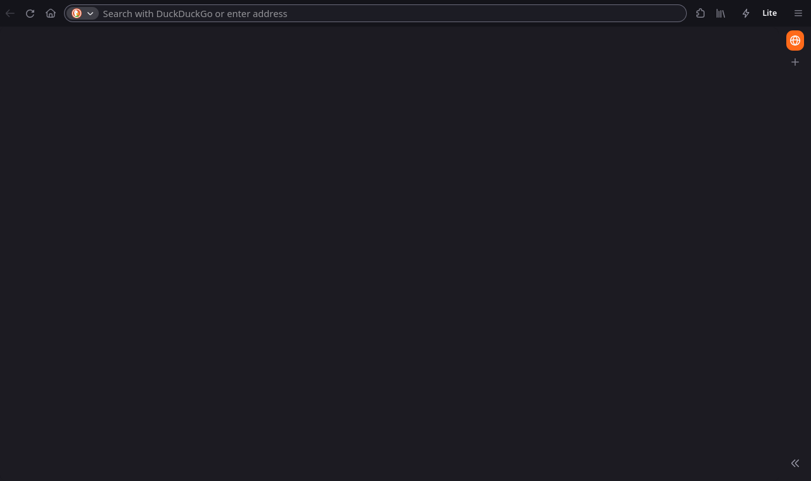
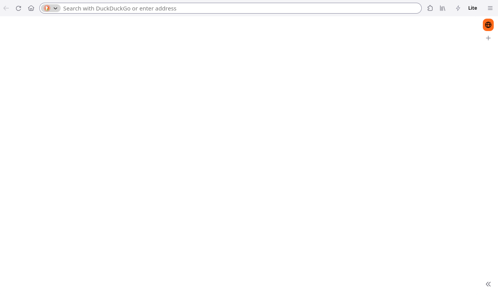
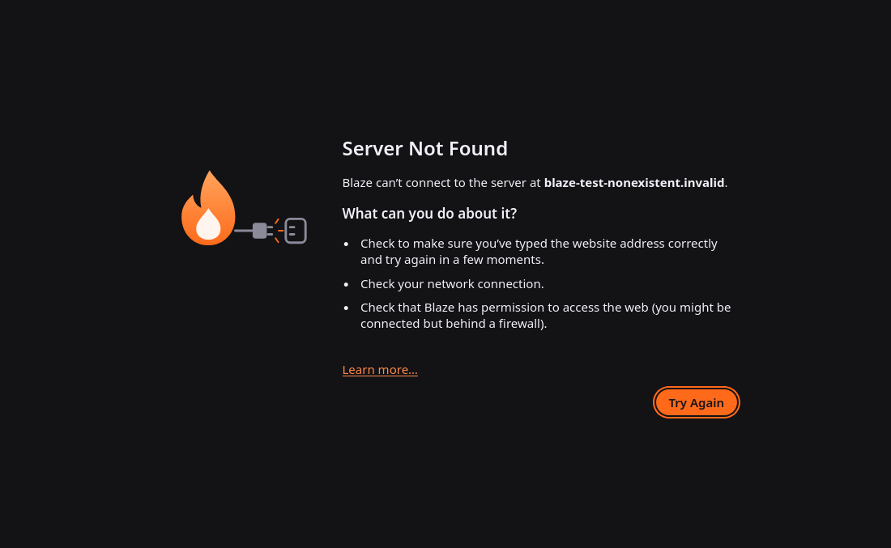
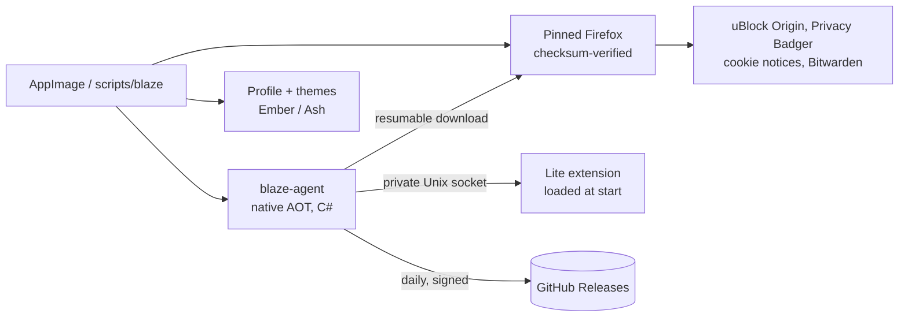

<p align="center">
  
</p>

<h1 align="center">Blaze</h1>

<p align="center">
  <b>A Firefox-based browser built for speed and a light footprint.</b><br>
  Fewer bytes per page, downloads that resume, private by default, and an interface that stays out of the way.
</p>

<p align="center">
  <a href="https://vezzulab.github.io/blaze/">Website</a> ·
  <a href="PRIVACY.md">Privacy</a> ·
  <a href="SECURITY.md">Security</a> ·
  <a href="docs/BENCHMARKS.md">Benchmarks</a> ·
  <a href="README.es.md">Español</a>
</p>

<p align="center">
  
  
  
</p>

<p align="center">
  
</p>

---

## What Blaze is

Blaze is a **Firefox-based browser**: a distribution of the official Firefox engine (Gecko), tuned for people on slow or metered connections and for machines with little memory. It runs the real Firefox, so the whole modern web works, including YouTube, Spotify and your extensions. On top of it Blaze adds:

- a tuned profile (fewer processes, small memory caches, a big persistent disk cache, no background chatter),
- a one-click **Lite mode**,
- a **resumable download engine**,
- a minimal interface with two themes,
- a launcher that pins a tested Firefox and a signed updater that tells you what changed before you decide,
- Blaze branding in place of Firefox's: the name in menus and dialogs, and error pages with Blaze artwork instead of Firefox's fox mascot.

Blaze is **not** a source-level fork and does not patch Gecko's code. On your machine it only swaps Firefox's name, a few strings and the error-page artwork for Blaze's (see [Known limits](#known-limits)). Everything that is not Firefox lives in this repository and is small enough to read in an afternoon.

> **Alpha software.** It works end to end (see [Status](#status)), but it is young. Read the limits below before you rely on it.

## Why it exists

A page that is light on a fast line can take minutes on a bad one. Blaze attacks the two things you can control: **how many bytes a page costs** and **what happens when the link drops**.

| Open cnn.com, cold cache | Data | Calculated time at 256 kbps |
|---|---:|---:|
| Firefox, as shipped | 6.8 MB | 3 min 41 s |
| Blaze | 4.7 MB (**-31%**) | 2 min 33 s |
| Blaze with Lite on | 3.8 MB (**-44%**) | 2 min 5 s |

| Memory, all processes together | Firefox | Blaze | |
|---|---:|---:|---:|
| One blank tab | 815 MB | 522 MB | **-36%** |
| One tab, Wikipedia | 878 MB | 637 MB | **-27%** |
| Four pages open | 1021 MB | 689 MB | **-33%** |

**Read these honestly.** One run each, on one machine (Fedora 44, headless Firefox 159, memory as PSS). Times are calculated from bytes, not measured, because network timing varies too much between runs. About 500 MB for a single tab is the floor we found with Gecko, and Blaze cannot make a video tab cheaper than it is. We only compared against Firefox: we have **not** measured other browsers and do not claim to be the lightest browser that exists. Method and caveats: [docs/BENCHMARKS.md](docs/BENCHMARKS.md).

## Features

| | |
|---|---|
| **Lite mode** | One switch at the top right of the toolbar stops images, web fonts and video from loading. 44% to 61% fewer bytes on heavy news pages. |
| **Downloads that resume** | Multi-connection engine with persistent state. Survives a crash, a power cut or a dropped link. Verified with a `kill -9` mid-download. See the [limit](#known-limits) below. |
| **Extensions** | uBlock Origin, Privacy Badger, I Still Don't Care About Cookies and Bitwarden are preinstalled and grouped in the extensions menu, so the toolbar stays clean. Any add-on from addons.mozilla.org works. |
| **Defaults that are yours to change** | DuckDuckGo as homepage and search engine, a short toolbar (back, reload, home, address bar, extensions menu, library, Lite), the tab strip on the right, and the window buttons as their own group. Applied once; changing them in Settings sticks. |
| **DRM** | Widevine is on, so Spotify and Netflix work. One setting turns it off. |
| **Private by default** | No telemetry, no accounts, HTTPS-only, strict tracking protection, no web push, no region lookup. Every server Blaze contacts is listed in [PRIVACY.md](PRIVACY.md). |
| **Update-proof** | Blaze pins a specific Firefox (checksum-verified) and switches off Firefox's own updater, so an upstream update cannot break the interface. A UI contract test guards every engine bump. |
| **Updates you decide** | Checks GitHub once a day, shows the release notes, downloads only when you say yes. Releases are signed with ECDSA; Blaze rejects anything that does not verify. |
| **Two themes** | **Ember** (dark) and **Ash** (light), following your system. Flat, compact, no blur or shadows, orange as the single accent. |
| **Looks like Blaze** | Menus, dialogs and error pages say Blaze and use Blaze artwork, not Firefox's mascot. See below. |
| **Small** | The Blaze app is an AppImage under 5 MB. Its agent is a native AOT binary (about 10 MB of RAM while downloading). |

<p align="center">
  
</p>
<p align="center"><sub>Captured from a real Blaze window. Only the interface is shown; the page area is empty because of how the screenshots are taken.</sub></p>

### Errors look like Blaze too

<p align="center">
  
</p>

## Install

**AppImage (Linux x86_64)**

```bash
# 1. download Blaze-0.1.1-x86_64.AppImage (plus SHA256SUMS and SHA256SUMS.sig to verify it) from the Releases page
chmod +x Blaze-*-x86_64.AppImage
./Blaze-*-x86_64.AppImage
```

The current release, **0.1.1** (alpha software), published on the [Releases page](https://github.com/vezzulab/blaze/releases) with its signature. **Do not use 0.1.0**: it ships an out-of-date Firefox. Prefer to build it yourself? See below. The first start downloads Firefox 160.0.1 from archive.mozilla.org (87 MB), verifies it against the SHA-256 pinned in [`engine.env`](engine.env), and installs the four extensions (about 38 MB, of which Bitwarden is 28). Interrupt it and it resumes. Firefox then fetches about 49 MB in the background (measured on Firefox 160.0.1: Mozilla's blocklists and data 26, Widevine 17, Safe Browsing 6.5). Altogether about 175 MB the first time, then a start is nearly silent. On a slow link, leave the first start running.

**From source** (needs the .NET 10 SDK with AOT support, `python3`, `curl`, `tar`, `xz`)

```bash
git clone https://github.com/vezzulab/blaze.git && cd blaze
dotnet publish src/Blaze.Agent -c Release -r linux-x64 -o dist/agent
scripts/blaze                      # run from the checkout
packaging/build-appimage.sh        # or build dist/Blaze-<version>-x86_64.AppImage
```

### Settings

Blaze keeps its switches deliberately simple: an environment variable or an empty file.

| What | Turn it off | Notes |
|---|---|---|
| DRM (Widevine) | `BLAZE_DRM=0` or `touch ~/.config/blaze/no-drm` | Spotify, Netflix and similar stop working. No contact with Google for the module. |
| Safe Browsing | `BLAZE_SAFEBROWSING=0` or `touch ~/.config/blaze/no-safebrowsing` | More private and lighter (about 10 MB less on first run), but no phishing warnings. |
| Daily update check | `BLAZE_NO_UPDATE_CHECK=1` or `touch ~/.config/blaze/no-update-check` | Check by hand with `blaze --update`. |
| Window buttons | `BLAZE_SYSTEM_TITLEBAR=1` or `touch ~/.config/blaze/system-titlebar` | By default Blaze draws minimize / maximize / close as their own group at the far right, apart from the navigation. This switch hands them back to your desktop's titlebar. |
| Language of Firefox | `BLAZE_LOCALE=es-MX` | `en-US`, `es-ES`, `es-MX`, `es-AR` are pinned. Default follows `$LANG`. |

## How it works



- **`src/Blaze.Core`** – the download engine (segments, `Range` + `If-Range`, fsync-before-state, backoff, wake on network return), the updater (signature, checksum, atomic swap) and the debugger client that loads the extension.
- **`src/Blaze.Agent`** – the command-line entry point, compiled to a native binary.
- **`scripts/blaze`** – the launcher: engine install, profile setup, update prompt, start.
- **`profile/`** – `user.js` (the tuned preferences) and the Ember/Ash interface CSS.
- **`extension/`** – the Lite companion extension (Manifest v2, declares no data collection).
- **`tools/ui.py`** – drives a real headless Firefox to check, and screenshot, the interface.

## Status

| Area | State |
|---|---|
| Tuned Firefox profile, Lite mode, themes | Working |
| Download engine | Working, covered by the 22-test suite. Runs from the command line. |
| Pinned engine + update-proofing + UI contract test | Working |
| Signed updater with release notes | Working, tested against a simulated GitHub (including forged and unsigned releases) |
| AppImage | Builds and starts with and without FUSE |
| DRM, Safe Browsing and update switches | Working |
| Blaze branding: name, menus, error pages and their artwork | Working. The engine starts as fast as the original (0.4 s to be ready, both). Covered by 1 unit test and the UI contract. |
| Right-hand vertical tab strip | Working on Firefox 160.0.1 (confirmed by screenshot). It was **missing on the 159.0 build** we shipped in 0.1.0. |
| Download engine inside the browser's download button | Planned |
| Lite exceptions per site | Planned |
| Own new-tab page and downloads panel | Planned |
| Permanent install of the companion extension | Planned (needs signing on addons.mozilla.org) |
| Default-browser integration, ARM64, other packaging | Planned |

### Known limits

- The download engine is not yet connected to Firefox's download button. Today it downloads Blaze's own components (the engine, the extensions, updates) and can be driven from a terminal: `blaze-agent get <url> --dir <folder>`.
- Release Firefox only accepts Mozilla-signed add-ons. Blaze therefore loads its Lite extension as a temporary add-on on each start, over a private Unix socket that is closed right after. It works, but it is not a permanent install.
- Pinning Firefox means Firefox's security fixes reach you **through Blaze releases**, not on their own. Following Firefox's release cadence is a maintenance rule of this project ([docs/MAINTAINING.md](docs/MAINTAINING.md)), and the update prompt is how you receive those fixes.
- **Blaze 0.1.0 shipped an out-of-date Firefox (159.0)** that lacks fixes for more than 100 CVEs published since, including sandbox escapes. Version 0.1.1 pins Firefox 160.0.1. If you installed 0.1.0, update, and avoid sensitive logins until you do. This is the cost of pinning the engine; see [SECURITY.md](SECURITY.md).
- Privacy Badger and Bitwarden may open a welcome tab the first time they install. We measured no connection to their own servers in the first 70 seconds, but did not watch a normal window.
- Rebranding rewrites two of the engine's resource archives on your machine at install time, as clean zip files. Firefox itself is not recompiled.
- Linux x86_64 only. CI workflows are written but have not run yet.

## Development

```bash
dotnet build
(cd tests/Blaze.Tests && dotnet run -c Release)      # 22 tests: resume, outages, forged updates, rate limits...
python3 tools/ui.py contract                         # needs the engine: run scripts/blaze once first
python3 tools/ui.py shot --scheme dark --out ember.png
```

Run the UI contract before changing `FIREFOX_VERSION` in `engine.env`. Firefox renames internal elements between releases (159 turned `#urlbar-background` into `.urlbar-background`); the contract catches that before users do.

## Security and privacy

- Releases are signed (ECDSA P-256); the private key never lives in the repository. Blaze refuses unsigned, forged or checksum-mismatched updates.
- The engine is downloaded over HTTPS and verified against a checksum pinned in this repository.
- No TCP port is opened. The one local channel is a Unix socket in a `0700` folder, removed after the extension loads.
- Download state is `0600` and never keeps cookies after a download finishes.

Details and the measured list of network connections: [SECURITY.md](SECURITY.md) and [PRIVACY.md](PRIVACY.md). To report a vulnerability, use GitHub's private reporting on this repository.

## License

[MIT](LICENSE). Blaze is not affiliated with or endorsed by Mozilla. Firefox and the Firefox logos are trademarks of the Mozilla Foundation. Fonts on the website are under the SIL Open Font License.
